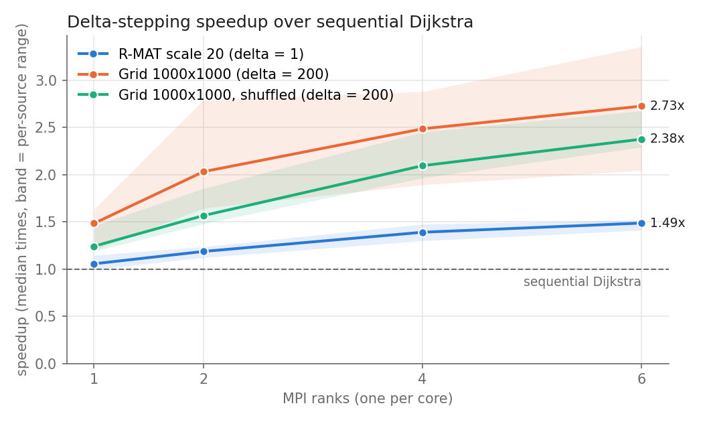
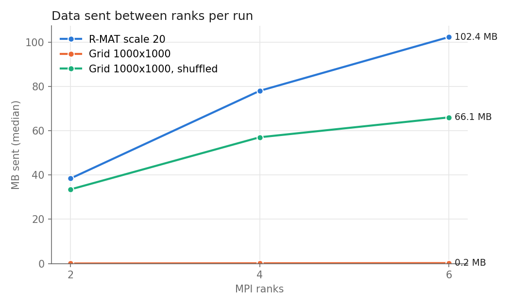
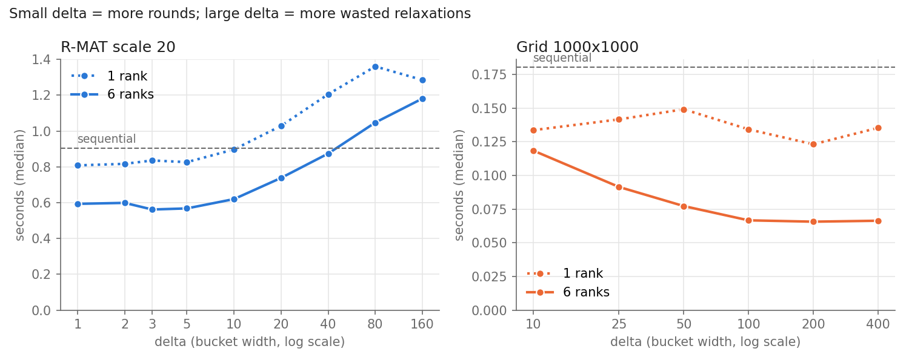

# Distributed Shortest Paths with MPI

Distributed single-source shortest paths (SSSP) in C++17 and OpenMPI using
**delta-stepping** (Meyer & Sanders). Each MPI rank loads and owns only its
block of a graph stored in binary CSR format. Updates for nodes owned by other
ranks are batched and exchanged once per phase with `MPI_Alltoallv`. Every run
can be checked against a sequential Dijkstra with `--verify`.

Tested on million-node synthetic graphs (Graph500-style R-MAT and 2D grids),
with timings taken as the median of 10 random sources.

## Results

One laptop (Ryzen 5 7535U, 6 physical cores, WSL2, on AC power), one MPI rank
per core, median of 10 sources. Each source is timed with both algorithms, and
graph loading is excluded from both.

| Graph | Nodes / directed edges | Sequential Dijkstra | Delta-stepping, 6 ranks | Speedup | Data sent between ranks |
|---|---|---|---|---|---|
| R-MAT scale 20 | 1,048,576 / 31.4M (646K reachable) | 0.85 s | 0.57 s | **1.48x** | 102 MB |
| Grid 1000x1000, shuffled | 1,000,000 / 4.0M | 0.46 s | 0.19 s | **2.39x** | 66 MB |
| Grid 1000x1000 | 1,000,000 / 4.0M | 0.185 s | 0.068 s | **2.69x** | 0.2 MB |



**Where the speedup comes from.** Delta-stepping on a single rank is already
faster than the heap-based Dijkstra, because bucket operations are cheaper than
heap operations. The table splits the total into that algorithmic part and the
part from adding cores:

| Graph | 1 rank vs sequential | 1 → 6 ranks | Total |
|---|---|---|---|
| R-MAT scale 20 | 1.05x | 1.41x | 1.48x |
| Grid, shuffled | 1.28x | 1.92x | 2.39x |
| Grid | 1.43x | 1.84x | 2.69x |

**Communication is what limits scaling.** Nodes are split into contiguous blocks
by id. In the unshuffled grid, each node's neighbours have nearby ids and usually
live on the same rank, so only 0.25% of edges cross ranks. That makes the grid a
best case. The shuffled grid is the same graph with random ids: 83% of edges
cross ranks (5/6, as expected for 6 ranks), and it sends 66 MB per run instead of
0.2 MB. R-MAT ids are also random, and its skewed degrees produce the most
traffic. Shuffling also makes sequential Dijkstra 2.5x slower, because
neighbouring nodes end up far apart in memory and miss the cache.



### Choosing delta

Delta (Δ) is the bucket width. A small Δ processes nodes in nearly exact
distance order, so little work is wasted, but it needs more synchronised phases.
A large Δ needs fewer phases but relaxes many edges more than once. The best Δ
depends on the graph, so it was chosen by sweeping (as practical
implementations such as GAP do):



- **R-MAT** is a small-world graph: its shortest paths are only a few hops long,
  so even Δ = 1 needs just ~190 phases, and each phase contains thousands of
  nodes to process in parallel. Larger Δ only adds wasted work: 73M relaxations
  at Δ = 160 vs 31.4M at Δ = 1. Δ from 1 to 5 performs the same within noise;
  Δ = 1 was used. With integer weights, Δ = 1 is effectively a distributed
  version of Dial's bucket-queue algorithm.
- **The grid** has paths about 1000 hops long. Δ = 10 needs about 9,800
  phases, each ending in a global synchronisation, so a wider Δ = 200 is faster
  despite the extra relaxations.

## How it works

1. **Graph generation** (`gen_graph`): R-MAT with Graph500 parameters
   (a = 0.57, b = c = 0.19) and node ids randomly permuted, or a 2D grid
   (optionally shuffled). The graph is undirected with integer weights in
   [1, 100] and is written as binary CSR: a header, then offsets, targets and
   weights.
2. **Partitioning and loading** (`local_graph.cpp`): rank *r* of *R* owns nodes
   `[n·r/R, n·(r+1)/R)` and reads only that slice of the file, so no rank holds
   the whole edge list.
3. **Delta-stepping** (`delta_stepping.cpp`). Each rank keeps distances and
   buckets for its own nodes only. Each round:
   - `MPI_Allreduce(MIN)` picks the smallest non-empty bucket across all ranks.
   - Light edges (w ≤ Δ) are relaxed in repeated phases until that bucket is
     empty on every rank.
   - Heavy edges (w > Δ) are relaxed once.
   - Targets on the same rank are updated directly.
   - Targets on other ranks are batched per destination rank, keeping only the
     smallest candidate per target node each phase. This cut traffic on R-MAT
     from 552 MB to 68 MB (4 ranks, Δ = 50).
4. **Exchange** (`exchange.h`): `MPI_Alltoall` exchanges the per-rank counts,
   then `MPI_Alltoallv` sends the requests themselves, using a custom MPI
   datatype for the request struct.
5. **Timing**: start with `MPI_Barrier` + `MPI_Wtime`, and report the slowest
   rank's time (max reduction).

## Build and run

Requires Ubuntu or WSL2 with OpenMPI (MPICH may fail on WSL2), CMake, g++,
GoogleTest and, for the plots, matplotlib:

```bash
sudo apt install libopenmpi-dev openmpi-bin cmake g++ libgtest-dev python3-matplotlib

cmake -S mpi_runtime -B build -DCMAKE_BUILD_TYPE=Release
cmake --build build -j
```

Generate graphs (`*.csr` files are gitignored; the R-MAT file is about 260 MB):

```bash
mkdir -p graphs
./build/gen_graph --type rmat --scale 20 --out graphs/rmat20.csr
./build/gen_graph --type grid --rows 1000 --cols 1000 --out graphs/grid.csr
./build/gen_graph --type grid --rows 1000 --cols 1000 --shuffle --out graphs/grid_shuf.csr
```

Run:

```bash
# delta-stepping on 6 ranks, checked against sequential Dijkstra
mpirun -n 6 --bind-to core ./build/sssp_mpi --graph graphs/grid.csr \
  --algo delta --delta 200 --source 0 --verify

# sequential baseline (1 rank)
mpirun -n 1 ./build/sssp_mpi --graph graphs/grid.csr --algo seq --source 0

# how the block partition splits the graph (edge cut, balance)
mpirun -n 6 ./build/sssp_mpi --graph graphs/rmat20.csr --algo partition-stats
```

Benchmarks and plots (results go to `experiments/results/`, charts to
`experiments/figures/`):

```bash
./experiments/bench.sh graphs/rmat20.csr rmat20 "1" "1 2 4 6"
./experiments/bench.sh graphs/grid.csr grid "200" "1 2 4 6"
./experiments/bench.sh graphs/grid_shuf.csr grid_shuf "200" "1 2 4 6"
RUNS=5 ./experiments/bench.sh graphs/rmat20.csr sweep_rmat20 "1 2 3 5 10 20 40 80 160" "1 6"
RUNS=5 ./experiments/bench.sh graphs/grid.csr sweep_grid "10 25 50 100 200 400" "1 6"
python3 experiments/plot.py
```

Tests:

```bash
./build/unit_tests
mpirun -n 4 ./build/mpi_tests
```

There are 8 tests: 5 unit tests and 3 MPI tests. They cover the CSR round
trip, the block partition, the exchange, and delta-stepping vs sequential
Dijkstra on a random graph for several sources and Δ values (Δ = 1, a middle
value, and Δ large enough to behave like Bellman-Ford). The MPI tests pass at
any rank count.

## Limitations

- **One machine.** All ranks share one CPU and memory system, so the
  "communication" here is shared-memory MPI, not a network. The code runs
  unchanged across machines (`mpirun --hostfile`), but that has not been
  measured.
- **Only 6 cores.** Scaling past 6 ranks was not measured.
- **Block partitioning only.** Graphs with random ids (R-MAT, the shuffled grid)
  get the worst-case edge cut. A real partitioner such as METIS would reduce
  traffic.
- **Memory is not fully distributed.** Each rank keeps a 4-byte deduplication
  slot per node of the *whole* graph (`sent_slot`, 4 MB at 1M nodes). Edges and
  distances are fully distributed.
- **Δ is tuned per graph by hand** using the sweep, not chosen automatically.
- Timings are wall-clock on a laptop. Runs on battery were noticeably slower
  and noisier, so all reported numbers were taken on AC power.

## Project history

This started as a course project (Jan–Apr 2026). That version (v1) replicated
the whole graph on every rank and ran a Dijkstra in which each step used a
global `MPI_Allreduce`, so ranks did redundant work and it did not scale. It
was tested on a 501-node graph with single-run timings. That version, which
also included FloodMax leader election and a report, is preserved at the
[`v1-course-project`](../../tree/v1-course-project) tag.

The current version (v2) replaces it with the distributed design above:
partitioned CSR input, delta-stepping with batched `Alltoallv` exchange,
large generated graphs, verification against a sequential reference, and
repeated, median-based measurements.

## AI usage

<!-- TODO(grantjlk): write this section — which parts you wrote, which parts were written with AI, and how you reviewed them. -->

## Repository layout

```
mpi_runtime/
  include/, src/
    gen_graph.cpp          R-MAT / grid generator -> binary CSR
    csr.cpp                CSR file format (read/write, validation)
    local_graph.cpp        block partition, per-rank partial load
    exchange.h             Alltoall + Alltoallv personalized exchange
    delta_stepping.cpp     distributed delta-stepping
    sssp_reference.cpp     sequential Dijkstra (baseline + verification)
    main.cpp               CLI
  tests/                   unit_tests.cpp, mpi_tests.cpp
experiments/
  bench.sh, plot.py        benchmark runner and charts
  results/, figures/       CSV results and PNG charts
```
